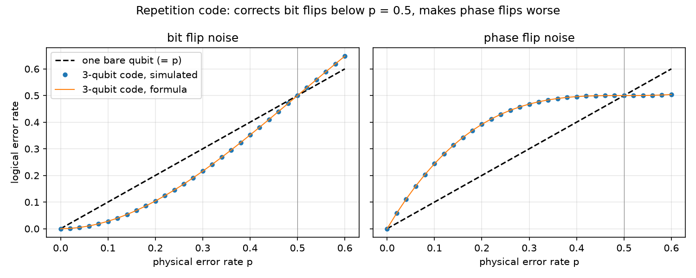

# Repetition code in PennyLane

The three-qubit repetition code, simulated exactly with PennyLane's density-matrix device: encode one logical qubit into three, add noise, measure the syndrome with ancillas, correct with a lookup table, and compare the logical error rate with the physical one.



**What it shows**
- **Bit flips:** encoding lowers the error rate for every p below 0.5, from p to 3p² − 2p³ (for small p, roughly 3p²).
- **Phase flips:** the code cannot see them (a Z changes no parity), so three qubits catch about three times as many errors as one. This is why codes that check both kinds of parity, such as the surface code, are needed. The next project, [`qec-vqc-decoder`](../qec-vqc-decoder), starts there.

**Checks** (`run.py`): each simulated curve is compared with its closed form, 3p²(1 − p) + p³ for bit flips and (1 − (1 − 2p)³)/2 for phase flips; they agree to about 1e-14.

## Run

```
uv run python run.py
```

## Files

| File | What it holds |
|---|---|
| `repetition_code.py` | encoding, syndrome measurement, lookup-table correction, the four circuits, the closed forms |
| `run.py` | sweep over p, the checks, the figure |
| `DECISIONS.md` | every design choice, the alternatives, and why |

## Next steps

- Noise on the ancillas and the CNOTs (circuit-level noise), and repeated syndrome rounds.
- The 9-qubit Shor code, which corrects both bit and phase flips.
